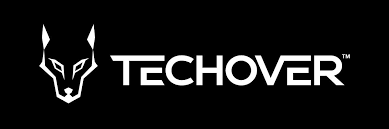

# Spotify Clone



En Spotify-klon byggd i **React** med **Vite** och **Material UI**. Appen kopplas mot mitt eget Spotify-konto via **Spotify Web API** och **Spotify Web Playback SDK**, så att jag kan bläddra i mitt bibliotek, söka och spela musik direkt i webbläsaren. Den har en vy för dator och en separat vy för mobil.

## Vad jag har byggt

### Inloggning och säkerhet
- Inloggning med Spotify via **OAuth 2.0 Authorization Code med PKCE** (`src/utils/pkce.js`). Inget client secret behövs i webbläsaren.
- Token sparas, kontrolleras och förnyas automatiskt när den gått ut (`getValidToken`, `refreshAccessToken`).
- **ProtectedRoute** skickar oinloggade användare till inloggningssidan.

### Datorvy (`/dashboard`)
- **Hem**: översikt med mina spellistor, toppartister med mera.
- **Sök**: sök efter låtar, artister, album och spellistor.
- **Bibliotek**: mina spellistor, sparade album och podcasts.
- **Gillade låtar** och **avsnitt** (sparade podcastavsnitt).
- Detaljsidor för **spellista**, **album**, **artist** och **podcast/show**.
- **Skapa spellista**.
- Sidomeny (`SideNav`), toppfält (`TopBar`) och låtlistor (`SongTable`, `SongRow`).

### Spelare
- Egen spelare i webbläsaren via Spotify Web Playback SDK (`Player.jsx`).
- Spela/pausa, nästa/föregående låt, spola, volym, shuffle och repeat.
- **Välj enhet**: flytta uppspelningen mellan webbläsaren, mobilen och andra Spotify-enheter (`DeviceModal`, `spotifyDevices.js`).

### Mobilvy (`/mobile`)
- En egen mobilanpassad layout (`MobileShell`) med bottennavigering.
- Hem, Sök, Bibliotek, Skapa och Spellista anpassade för mobil.
- **Miniplayer** längst ner och helskärmsvyn **Spelas nu**.

### Övrigt
- Eget mörkt tema i Material UI (`src/theme/material-theme.js`).
- Laddnings- och tomma lägen (`LoadingState`, `EmptyState`).
- **Device Lab** (`/device-lab`): en testsida för enhetsval.

## Tekniker
- React 18 och Vite
- React Router v6
- Material UI och MUI Icons
- Spotify Web API och Spotify Web Playback SDK

## Projektstruktur
```
src/
├── components/   # Återanvändbara komponenter (Player, SideNav, SongTable, mobilkomponenter …)
├── pages/        # Sidor för dator och mobil
├── utils/        # Inloggning/token, PKCE, uppspelning, enheter, formatering
├── config/       # Spotify-inställningar (client id, redirect, scopes)
└── theme/        # Material UI-tema
```

## Kör projektet lokalt

1. Skapa en app på [Spotify Developer Dashboard](https://developer.spotify.com/dashboard).
2. Lägg till Redirect URI: `http://127.0.0.1:5173/callback`
3. Kopiera `.env.example` till `.env` och fyll i ditt Client ID:
   ```
   VITE_CLIENT_ID=ditt-client-id
   ```
4. Installera och starta:
   ```bash
   npm install
   npm run dev
   ```
5. Öppna `http://127.0.0.1:5173` och logga in med ditt Spotify-konto.

> **OBS:** Uppspelning kräver Spotify Premium. Spotify-appar i utvecklingsläge kan bara användas av konton som har lagts till under **Users and access** i dashboarden.

## Bakgrund
Projektet byggdes som en del av utbildningen på Tech Over / TSM, utifrån startprojektet [MMR-Solutions-AB/tsm-spotify](https://github.com/MMR-Solutions-AB/tsm-spotify). Jag har sedan byggt vidare med fler sidor, mobilvy, enhetsval och PKCE-inloggning.
